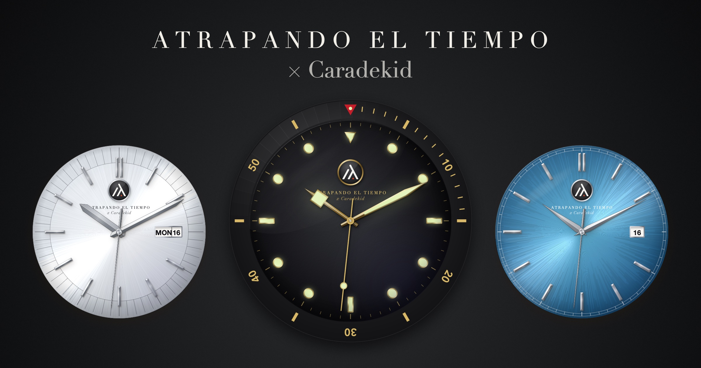
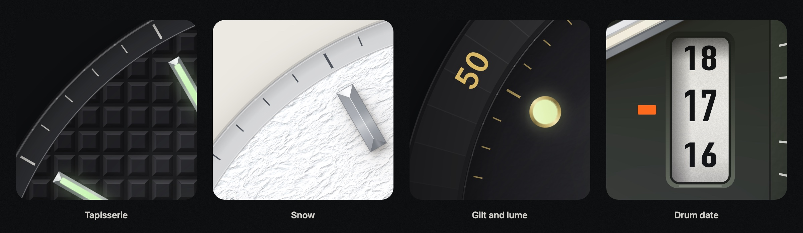
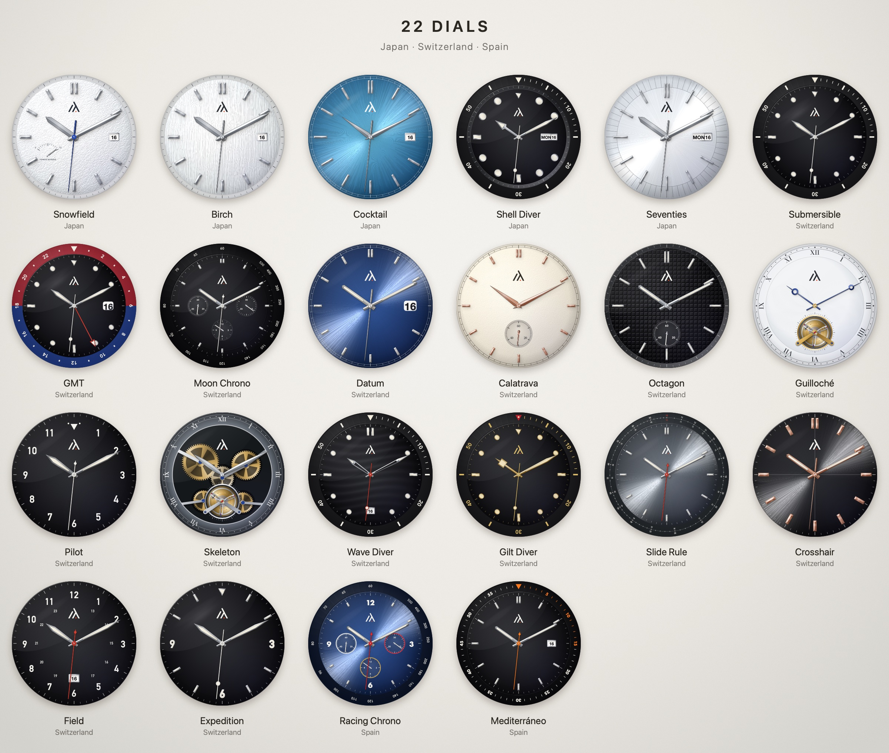
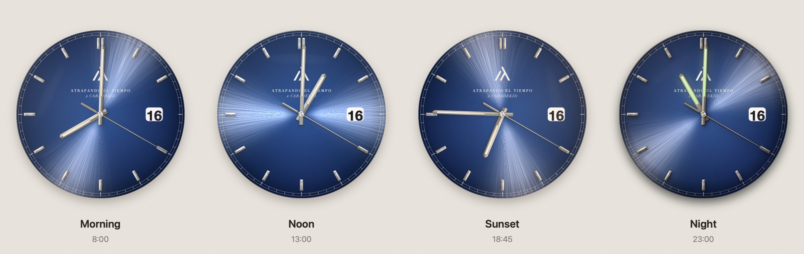
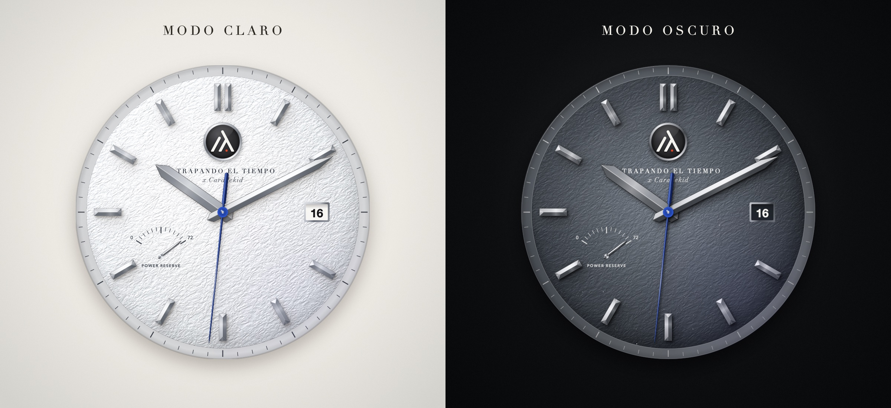

<p align="center">
  
</p>

<h1 align="center">Atrapando el tiempo × Caradekid</h1>

<p align="center">
  <b>Live, photorealistic watch dials as your wallpaper, on Mac and PC.</b><br>
  They show the real time, change with the daylight and work offline.
</p>

<p align="center">
  <a href="https://github.com/caradekid/atrapando-el-tiempo/releases/latest"></a>
  
  
  
</p>

<p align="center">
  A gift from <a href="https://www.instagram.com/caradekid.jpg/"><b>Caradekid</b></a> to the <a href="https://www.youtube.com/@AtrapandoelTiempo"><b>Atrapando el tiempo</b></a> channel and its community.<br>
  <sub><a href="README.md">Versión en español</a></sub>
</p>

---

## ✦ What it is

A wallpaper that is a real watch. Pick a dial inspired by the great Japanese, Swiss and Spanish classics and it sits on your desktop showing your computer's time, with the seconds hand moving like the real one: gliding like a Spring Drive, in small steps like an automatic, or ticking like quartz.

Everything is drawn live, with no images: textured surfaces lit on the GPU, gem-cut indices, polished hands that flash as they turn, lume that glows at night and a sapphire crystal with its reflections. Every dial carries the channel's medallion.

<p align="center"></p>

## ✦ The collection

22 dials, from dress watches to divers, chronographs, pilots and field watches, each with its own colours, hands and seconds rhythm.

<p align="center"></p>

| Origin | Dials |
| --- | --- |
| 🇯🇵 Japan | **Snowfield** (snow texture, power reserve, blued seconds) · **Birch** (birch bark) · **Cocktail** (grooved sunray) · **Shell Diver** (diver, day-date) · **Seventies** (two-zone 70s silver) |
| 🇨🇭 Switzerland | **Submersible** · **GMT** · **Moon Chrono** (with the "dot over 90") · **Datum** · **Calatrava** · **Octagon** (tapisserie) · **Guilloché** (with tourbillon) · **Pilot** · **Skeleton** · **Wave Diver** · **Gilt Diver** · **Slide Rule** · **Crosshair** · **Field** · **Expedition** |
| 🇪🇸 Spain | **Racing Chrono** · **Mediterráneo** (vintage compressor diver) |

> The designs are *inspired by* well-known styles. They don't reproduce watch brand names or logos: the signature on the dial is whatever you type.

## ✦ Living light

The light follows the time of day: from the left in the morning, from above at noon, amber from the right at sunset, and a warm desk lamp at night. Moving the mouse turns the light as if you tilted the watch under a lamp, sweeping reflections across the dial, hands and crystal.

<p align="center"></p>

## ✦ Light and dark

It follows the system's light or dark mode. Each dial can have its own night version, and the lume glows in the dark.

<p align="center"></p>

## ✦ Install

### 🍎 Mac

1. **[Download the `.dmg`](https://github.com/caradekid/atrapando-el-tiempo/releases/latest)** and open it.
2. Drag **Atrapando el Tiempo** onto **Applications** and open it. The channel logo appears in the menu bar.
3. **The first time**, macOS warns that it can't verify the developer (it's a free gift, not signed with a paid Apple certificate):
   - **macOS 15 or later:** try to open it, close the warning, then go to **System Settings → Privacy & Security → Open Anyway**.
   - **macOS 13 and 14:** right-click the app → **Open** → **Open**.

From the menu bar you can:

- turn the **live wallpaper** on or off
- open **Settings**, with a live preview
- put the dial on the **login and lock screen** (light and dark image)
- install the **screen saver**, which shows the animated watch
- **open at login**
- visit the **[Atrapando el tiempo](https://www.youtube.com/@AtrapandoelTiempo)** channel

Requires macOS 13 or later; runs on Apple Silicon and Intel.

### 🪟 Windows

On Windows it runs in **[Lively Wallpaper](https://www.rocksdanister.com/lively/)**, a free app (also in the Microsoft Store):

1. Download **`Atrapando-el-Tiempo-Lively-….zip`** from the [latest release](https://github.com/caradekid/atrapando-el-tiempo/releases/latest).
2. Drag it into Lively (or **+ Add wallpaper** → choose the file) and set it as your wallpaper.
3. Use **Customise** to pick the watch, colours, size, medallion, light and more. Lively can also run it as a screen saver and pauses it while you play fullscreen.

On Windows the lettering uses built-in typefaces (Bahnschrift, Segoe UI, Palatino), so it looks slightly different from the Mac.

## ✦ Make it yours

Day and night dial, metal for hands and indices, outer ring, date, central seconds, a tourbillon on any dial, lume, AET medallion, signature and typeface, background (studio, spotlight or solid) and its colours, position, size (very small, small, medium or large), light (time of day or studio) and smoothness (60, 30 or 15 fps to save battery).

## ✦ For the curious

<details>
<summary><b>How it's made</b></summary>

- One web engine (Canvas 2D + WebGL) draws the dial on the desktop, the screen saver, the login image, the editor and on Windows, so it looks the same everywhere.
- The dial surface is computed on the GPU in a shader: relief, brushed metal with anisotropic highlights on sunray finishes, glints in the snow and a softbox reflected in lacquer. Without WebGL it falls back to CPU textures.
- The background is computed per pixel with a fine grain, so dark gradients never band.
- The Mac app is written in Swift (AppKit + WebKit) and needs no connection.

```
web/            Engine and editor (no dependencies)
  gl.js         GPU dial surfaces (GLSL)
  engine.js     Dials, printing, hands, tourbillon, light, light/dark
  app.js        Editor and native bridge
  wallpaper.html, lively.js   Windows entry (Lively)
native/App      Menu bar app (Swift)
native/Saver    Screen saver (ScreenSaver.framework)
scripts/        render.swift (PNG/HEIC) and build-lively.mjs
docs/           Images for this page (generated by poster.html)
```

</details>

<details>
<summary><b>Build from source</b></summary>

You need the Command Line Tools (`xcode-select --install`); full Xcode isn't required.

```bash
git clone https://github.com/caradekid/atrapando-el-tiempo.git
```

```bash
cd atrapando-el-tiempo && make install
```

- `make dmg VERSION=1.2.0` builds the `.dmg`.
- `make lively VERSION=1.2.0` builds the Windows package (needs Node.js).
- Pushing a tag (`git tag v1.2.0 && git push origin v1.2.0`) makes GitHub Actions build both and publish a release.
- Open `web/index.html` in a browser to design your dial and download it as a PNG.

</details>

## ✦ Credits

Concept and design by **[Caradekid](https://www.instagram.com/caradekid.jpg/)** for **[Atrapando el tiempo](https://www.youtube.com/@AtrapandoelTiempo)**. The channel emblem belongs to Atrapando el tiempo and is used here for this gift. The code is MIT-licensed; the emblem is not covered by that licence.
