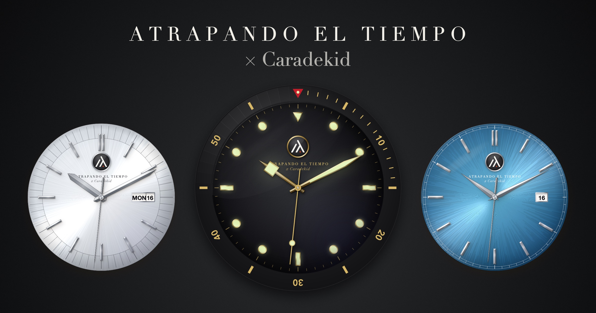
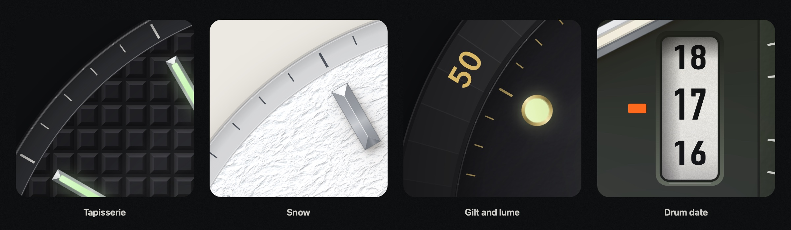
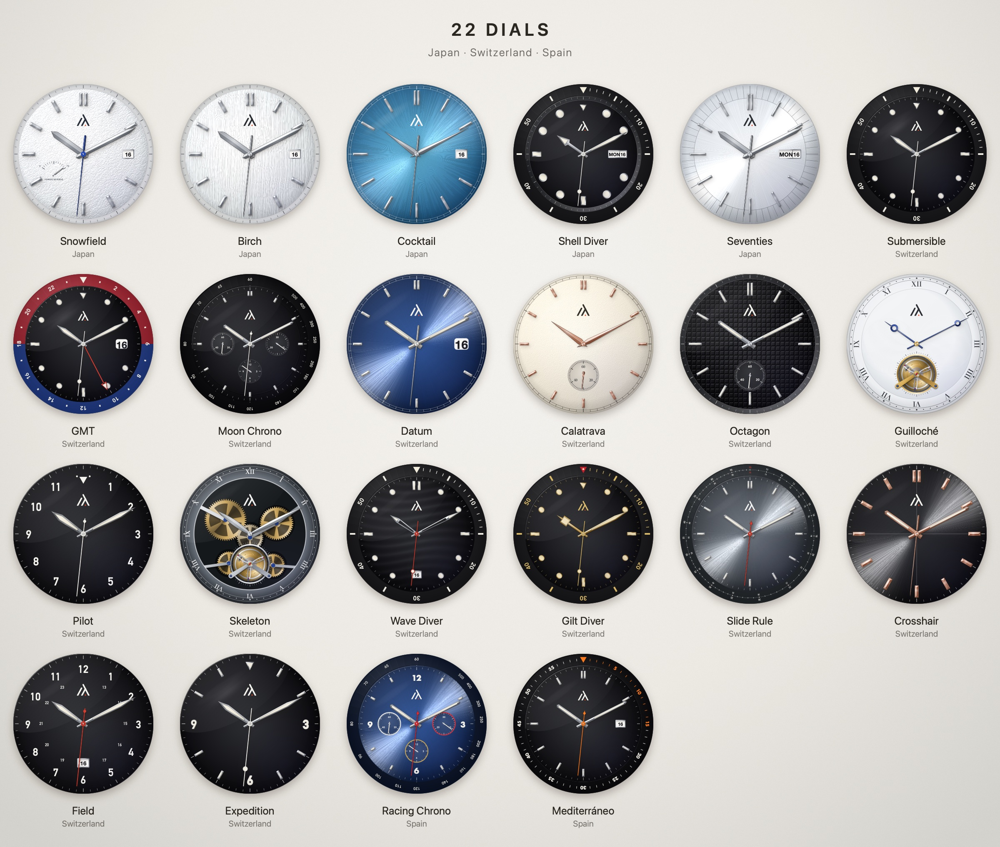
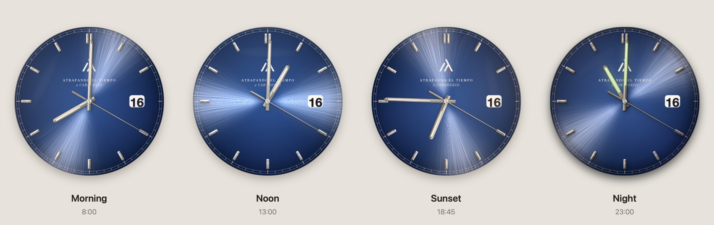
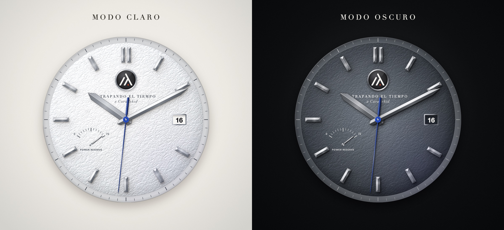

<p align="center">
  
</p>

<h1 align="center">Atrapando el tiempo × CARADEKID</h1>

<p align="center">
  <b>Esferas de reloj vivas y fotorrealistas como fondo de pantalla para Mac y PC.</b><br>
  Marcan la hora real, cambian con la luz del día y funcionan sin conexión.
</p>

<p align="center">
  <a href="https://github.com/caradekid/atrapando-el-tiempo/releases/latest"></a>
  
  
  
</p>

<p align="center">
  Un regalo de <a href="https://www.instagram.com/caradekid.jpg/"><b>CARADEKID</b></a> para el canal <a href="https://www.youtube.com/@AtrapandoelTiempo"><b>Atrapando el tiempo</b></a> y su comunidad.<br>
  <sub><a href="README.md">English</a> · Español</sub>
</p>

---

## ✦ Qué es

Un fondo de pantalla que es un reloj de verdad. Eliges una esfera inspirada en los grandes clásicos japoneses, suizos y españoles, y queda en tu escritorio marcando la hora de tu ordenador, con el segundero moviéndose como el del reloj real: deslizándose en un Spring Drive, a pequeños saltos en un automático o con el tic del cuarzo.

Todo se dibuja en tiempo real, sin imágenes: texturas en relieve calculadas en la tarjeta gráfica, índices tallados como gemas, agujas pulidas que brillan al girar, lume que se ilumina por la noche y un cristal de zafiro con sus reflejos. Cada esfera lleva el medallón del canal.

<p align="center"></p>

## ✦ La colección

22 esferas, de las de vestir a las de buceo, pasando por cronógrafos, pilotos y relojes de campo. Cada una con sus colores, su forma de aguja y su ritmo de segundero.

<p align="center"></p>

| Origen | Esferas |
| --- | --- |
| 🇯🇵 Japón | **Snowfield** (textura de nieve, reserva de marcha, segundero azulado) · **Birch** (corteza de abedul) · **Cocktail** (rayos en surcos) · **Shell Diver** (buceo, día y fecha) · **Seventies** (plata de los 70 en dos zonas) |
| 🇨🇭 Suiza | **Submersible** · **GMT** · **Moon Chrono** (con el «punto sobre el 90») · **Datum** · **Calatrava** · **Octagon** (tapisserie) · **Guilloché** (con tourbillon) · **Pilot** · **Skeleton** · **Wave Diver** · **Gilt Diver** · **Slide Rule** · **Crosshair** · **Field** · **Expedition** |
| 🇪🇸 España | **Racing Chrono** · **Mediterráneo** (buzo vintage *compressor*) |

> Los diseños están *inspirados* en estilos conocidos. No reproducen nombres ni logotipos de marcas de relojes: la firma de la esfera es la que tú escribas.

## ✦ Luz viva

La luz sigue la hora del día: por la mañana entra por la izquierda, a mediodía desde arriba, al atardecer desde la derecha con un tono ámbar, y de noche es una lámpara cálida de escritorio. Al mover el ratón, la luz gira como si inclinaras el reloj bajo una lámpara, y los reflejos recorren la esfera, las agujas y el cristal.

<p align="center"></p>

## ✦ Claro y oscuro

Sigue el modo claro u oscuro del sistema. Cada esfera puede tener su versión de noche, y el lume brilla en la oscuridad.

<p align="center"></p>

## ✦ Instalación

### 🍎 Mac

1. **[Descarga el `.dmg`](https://github.com/caradekid/atrapando-el-tiempo/releases/latest)** y ábrelo.
2. Arrastra **Atrapando el Tiempo** a **Aplicaciones** y ábrela. El logo del canal aparece en la barra de menús.
3. **La primera vez**, macOS avisa de que no puede verificar al desarrollador (es un regalo gratuito, sin certificado de pago de Apple):
   - **macOS 15 o posterior:** intenta abrirla, cierra el aviso y ve a **Ajustes del Sistema → Privacidad y seguridad → Abrir igualmente**.
   - **macOS 13 y 14:** clic derecho en la app → **Abrir** → **Abrir**.

Desde la barra de menús puedes:

- encender o apagar el **fondo vivo**
- abrir los **Ajustes**, con vista previa en directo
- poner la esfera en la **pantalla de inicio de sesión y bloqueo** (imagen clara y oscura)
- instalar el **salvapantallas**, que muestra el reloj animado
- abrir la app **al iniciar sesión**
- visitar el canal **[Atrapando el tiempo](https://www.youtube.com/@AtrapandoelTiempo)**

Necesita macOS 13 o posterior; funciona en Apple Silicon e Intel.

### 🪟 Windows

En Windows funciona con **[Lively Wallpaper](https://www.rocksdanister.com/lively/)**, una app gratuita (también en Microsoft Store):

1. Descarga **`Atrapando-el-Tiempo-Lively-….zip`** desde la [última versión](https://github.com/caradekid/atrapando-el-tiempo/releases/latest).
2. Arrástralo a Lively (o **+ Añadir fondo** → elige el archivo) y ponlo como fondo.
3. En **Personalizar** eliges reloj, colores, tamaño, medallón, luz y más. Lively también puede usarlo como salvapantallas y lo pausa cuando juegas a pantalla completa.

En Windows las tipografías usan las del sistema (Bahnschrift, Segoe UI, Palatino), así que las letras cambian un poco respecto al Mac.

## ✦ Personaliza tu reloj

Esfera de día y de noche, metal de agujas e índices, anillo exterior, fecha, segundero central, tourbillon en cualquier esfera, lume, medallón AET, firma y tipografía, fondo (estudio, foco o liso) con sus colores, posición, tamaño (muy pequeño, pequeño, mediano o grande), luz (hora del día o estudio) y fluidez (60, 30 o 15 fps para ahorrar batería).

## ✦ Para curiosos

<details>
<summary><b>Cómo está hecho</b></summary>

- Un único motor web (Canvas 2D + WebGL) dibuja la esfera en el escritorio, el salvapantallas, la imagen de inicio de sesión, el editor y Windows, así que se ve igual en todas partes.
- La superficie de la esfera se calcula en la GPU con un *shader*: relieve, metal cepillado con brillo anisotrópico en los rayos de sol, destellos en la nieve y un *softbox* reflejado en la laca. Si no hay WebGL, usa texturas calculadas en la CPU.
- El fondo se calcula píxel a píxel con un grano fino, para que los degradados oscuros no hagan escalones.
- La app de Mac está escrita en Swift (AppKit + WebKit) y no necesita conexión.

```
web/            Motor y editor (sin dependencias)
  gl.js         Superficies de esfera en la GPU (GLSL)
  engine.js     Esferas, impresión, agujas, tourbillon, luz, claro/oscuro
  app.js        Editor y puente con la app nativa
  wallpaper.html, lively.js   Entrada para Windows (Lively)
native/App      App de la barra de menús (Swift)
native/Saver    Salvapantallas (ScreenSaver.framework)
scripts/        render.swift (PNG/HEIC) y build-lively.mjs
docs/           Imágenes de esta página (poster.html las genera)
```

</details>

<details>
<summary><b>Compilar desde el código</b></summary>

Necesitas las Command Line Tools (`xcode-select --install`); no hace falta Xcode completo.

```bash
git clone https://github.com/caradekid/atrapando-el-tiempo.git
```

```bash
cd atrapando-el-tiempo && make install
```

- `make dmg VERSION=1.2.0` crea el `.dmg`.
- `make lively VERSION=1.2.0` crea el paquete de Windows (necesita Node.js).
- Al publicar una etiqueta (`git tag v1.2.0 && git push origin v1.2.0`), GitHub Actions compila ambos y crea la versión.
- Abre `web/index.html` en un navegador para diseñar tu esfera y descargarla como PNG.

</details>

## ✦ Créditos

Idea y diseño de **[CARADEKID](https://www.instagram.com/caradekid.jpg/)** para **[Atrapando el tiempo](https://www.youtube.com/@AtrapandoelTiempo)**. El emblema del canal pertenece a Atrapando el tiempo y se usa con motivo de este regalo. El código tiene licencia MIT; el emblema no está incluido en esa licencia.
