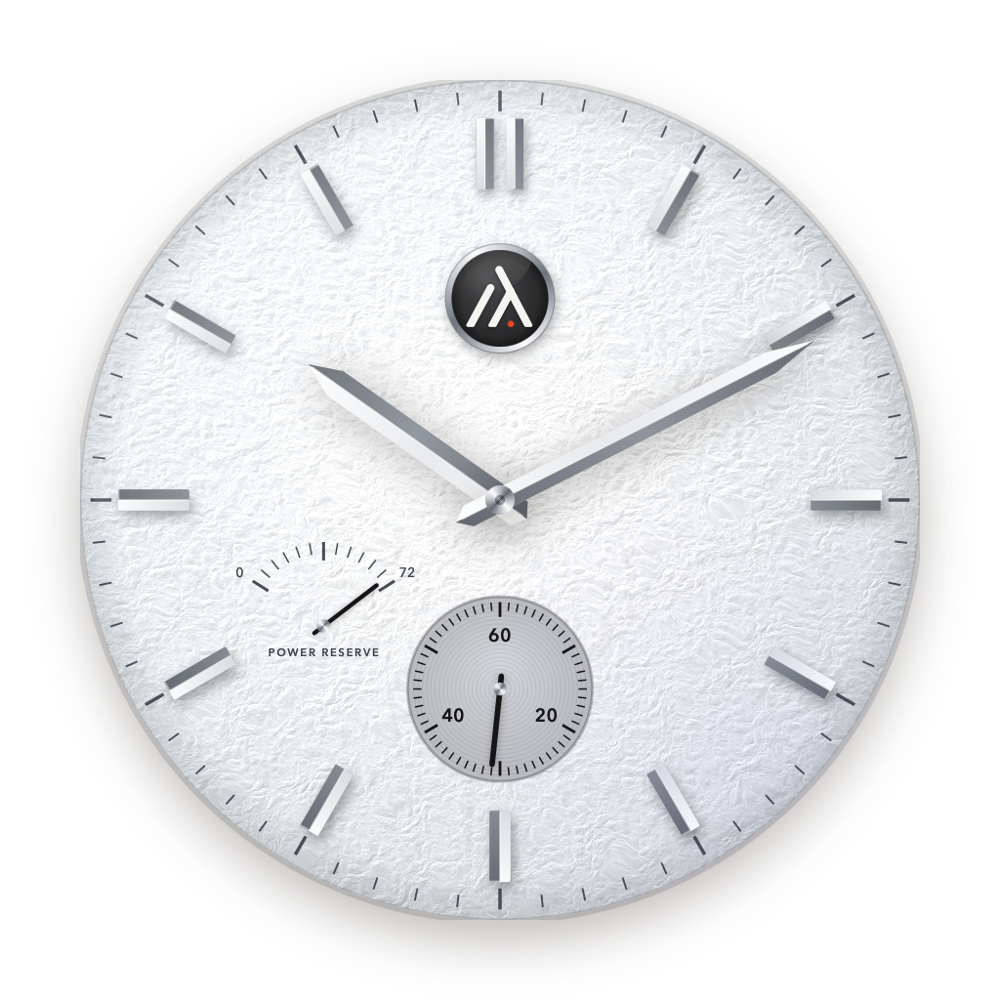
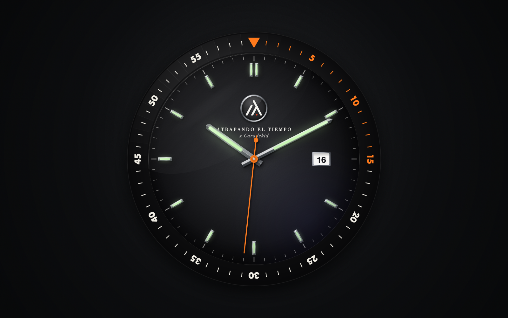
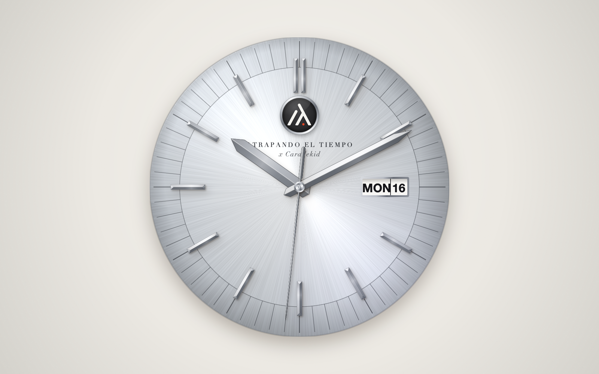
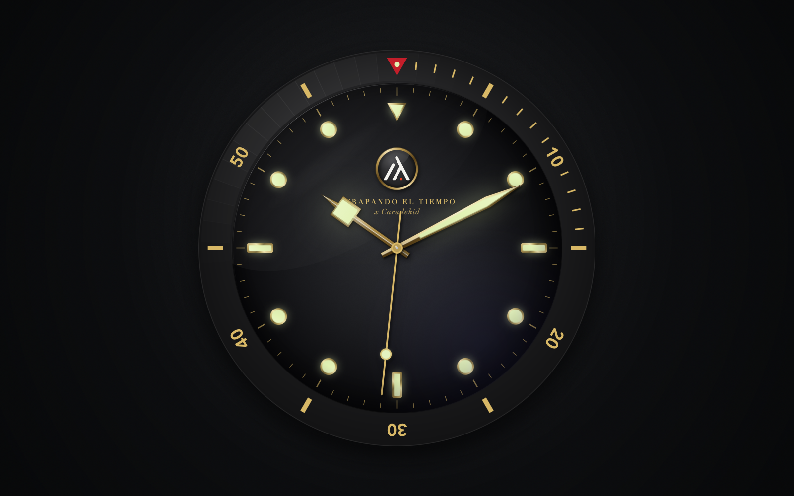

# Atrapando el tiempo × Caradekid

<p align="center"></p>

A gift from **Caradekid** to the **Atrapando el tiempo** channel and its community. Every dial carries the channel emblem as an applied medallion: a polished bezel, charcoal enamel and the mark with its red dot, redrawn as vectors so it stays sharp at any size.

**Live watch-dial wallpaper for macOS.** Photorealistic dials inspired by the great Japanese, Swiss and Spanish classics, showing your Mac's real time. Works 100 % offline, follows Light and Dark mode, and also covers the **login screen**, the **lock screen** and the **screen saver**.

<p align="center">
  
  
  
  
  
  
</p>

## What it does

| Where | How |
| --- | --- |
| **Desktop** | Live dial at 60 fps, synced to the system clock and time zone. Sits below the Finder icons and pauses itself when hidden or when the display sleeps. |
| **Login and lock screen** | *Apply to login & lock screen* renders a light/dark HEIC (the format Apple uses for its own dynamic wallpapers) at your display's native resolution. |
| **Screen saver** | *Atrapando el Tiempo* runs the same live dial. It appears on the lock screen when the Mac is idle. |
| **Living light** | The key light follows the time of day: from the left in the morning, from above at noon, amber from the right at sunset, a warm desk lamp at night. Reflections on hands, indices, dial and crystal move with it, and the crystal and hands shift slightly as you move the cursor, like tilting a real watch. |
| **Light / Dark** | Follows macOS automatically. Each dial can have its own *night* version, and the lume glows in dark mode. |

> **About the login window:** macOS only allows a **still** image there, so it shows the design at 10:10 (the classic watch-advert pose). The live animation runs on the desktop and in the screen saver.

## Collection

All dials are procedural (no image files). Dial surfaces are rendered on the GPU (WebGL): relief, anisotropic brushed metal on sunray finishes, glints in the snow and a softbox in gloss lacquer, all lit live and shifting as you move the cursor (with an automatic CPU fallback). On top: faceted indices and hands, drop shadows, a sapphire crystal with reflection, and the seconds motion of each type of movement.

| Origin | Dial | Signature details |
| --- | --- | --- |
| 🇯🇵 Japan | **Snowfield** | Wind-swept snow texture, *glide* seconds (continuous), power reserve, blued hand |
| 🇯🇵 Japan | **Birch** | Vertical bark relief, *razor* faceted hands, 8 beats/s |
| 🇯🇵 Japan | **Cocktail** | Radial grooves with a sunray flare, dauphine hands |
| 🇯🇵 Japan | **Shell Diver** | Large lume plots, day-date, dive scale |
| 🇯🇵 Japan | **Seventies** | Two-zone silver sunray, radial minute lines, day-date with a blue Saturday |
| 🇨🇭 Switzerland | **Submersible** | Gloss dial, round plots, date magnifier (cyclops) |
| 🇨🇭 Switzerland | **GMT** | Two-tone 24 h scale and second time-zone hand |
| 🇨🇭 Switzerland | **Moon Chrono** | Matte black, three registers, tachymeter |
| 🇨🇭 Switzerland | **Datum** | Sunburst, date with magnifier |
| 🇨🇭 Switzerland | **Calatrava** | Dress dial, opaline, small seconds |
| 🇨🇭 Switzerland | **Octagon** | Black tapisserie grid, small seconds, inner flange |
| 🇨🇭 Switzerland | **Guilloché** | Engine-turned guilloché, Roman numerals, pomme hands, **tourbillon** |
| 🇨🇭 Switzerland | **Pilot** | Large aviation numerals, triangle at 12 |
| 🇨🇭 Switzerland | **Skeleton** | Open-worked movement and **tourbillon** |
| 🇨🇭 Switzerland | **Wave Diver** | Engraved wave dial, skeleton hands, double bar at 12, date at 6 |
| 🇨🇭 Switzerland | **Gilt Diver** | Gilt printing, snowflake hands, aged lume, red triangle on the bezel |
| 🇨🇭 Switzerland | **Slide Rule** | Aviation slide-rule scales around a grey sunray dial |
| 🇨🇭 Switzerland | **Crosshair** | Black sunray, printed crosshair, rose-gold indices |
| 🇨🇭 Switzerland | **Field** | Bold 1–12 with an inner 13–24 ring, date at 6, quartz tick |
| 🇨🇭 Switzerland | **Expedition** | Applied 3-6-9 numerals in metal and lume, gloss black |
| 🇪🇸 Spain | **Racing Chrono** | Racing chronograph, colour registers, quartz tick |
| 🇪🇸 Spain | **Mediterráneo** | Vintage *compressor* diver with an inner scale and orange accents |

**Customisable:** channel emblem (medallion, printed or off), dial colour (day and night), metal of the hands and indices, outer ring colour, date, central seconds, tourbillon (on any dial), lume, signature text and typeface, background (studio, spotlight, solid) with light/dark colours, position, size (very small, small, medium or large) and frame rate (60/30/15 fps to save battery).

> The designs are *inspired by* well-known styles. They do not reproduce watch brand names or logos. The signature defaults to *ATRAPANDO EL TIEMPO · x Caradekid* and you can change it.

## Install

**[Download the latest .dmg](https://github.com/caradekid/atrapando-el-tiempo/releases/latest)**, open it and drag **Atrapando el Tiempo** onto **Applications**. It needs macOS 13 or later and runs on Apple Silicon and Intel.

The app is a free gift and isn't signed with a paid Apple certificate, so **the first time** macOS may say it can't verify the developer:

- **macOS 15 or later:** try to open it once, then go to **System Settings → Privacy & Security** and click **Open Anyway**.
- **macOS 13–14:** right-click the app in Applications, choose **Open**, then **Open** again.

You only do this once. The `.dmg` includes a short guide in English and Spanish.

### Build from source

You need the Command Line Tools (`xcode-select --install`). Full Xcode is not required.

```bash
git clone https://github.com/caradekid/atrapando-el-tiempo.git
```

```bash
cd atrapando-el-tiempo && make install
```

`make install` builds a universal app (Apple Silicon + Intel), copies it to `/Applications/Atrapando el Tiempo.app` (or `~/Applications` if `/Applications` isn't writable) and opens it. The channel logo appears in the menu bar:

- **Live Wallpaper** — turns the live dial on or off
- **Settings…** — editor with a live preview
- **Apply to Login & Lock Screen** — generates and sets the light/dark image
- **Install Screen Saver…** — installs it and opens System Settings so you can choose *Atrapando el Tiempo*
- **Open at Login**

Every change you make in Settings is applied instantly to the desktop and to the installed screen saver.

### No installation

Open `web/index.html` in a browser to design your dial and download it as a PNG (light and dark). `web/gallery.html` shows the whole collection.

### Publishing a release

Push a version tag and GitHub Actions builds the universal `.dmg` and attaches it to a new release:

```bash
git tag v1.1.0 && git push origin v1.1.0
```

`make dmg VERSION=1.1.0` builds the same `.dmg` locally in `build/`.

## Structure

```
web/            Rendering engine (Canvas 2D, no dependencies) and editor
  gl.js         GPU dial surfaces (GLSL shader)
  engine.js     Dials, printing, hands, tourbillon, channel emblem, light/dark
  app.js        Editor and native bridge
native/App      Menu bar app (Swift/AppKit + WebKit)
native/Saver    Screen saver (ScreenSaver.framework + WebKit)
scripts/        render.swift: renders PNG/HEIC without touching the desktop
assets/         App icon and screen saver thumbnail
```

The same engine powers the desktop, the screen saver, the login image and the browser, so all four always look identical.

```bash
swift scripts/render.swift docs/test.png 2880 1800 dark cocktail
```

## Credits

Concept and design by **Caradekid** for **Atrapando el tiempo**. The channel emblem belongs to Atrapando el tiempo and is used here with that gift in mind. The code is MIT-licensed; the emblem is not covered by that license.

## License

MIT (code only)
