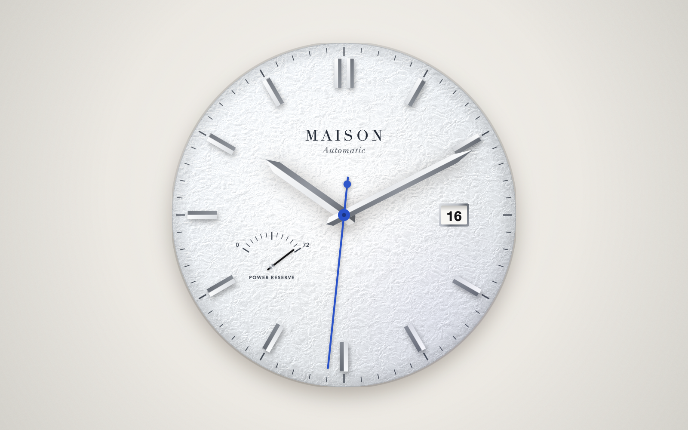
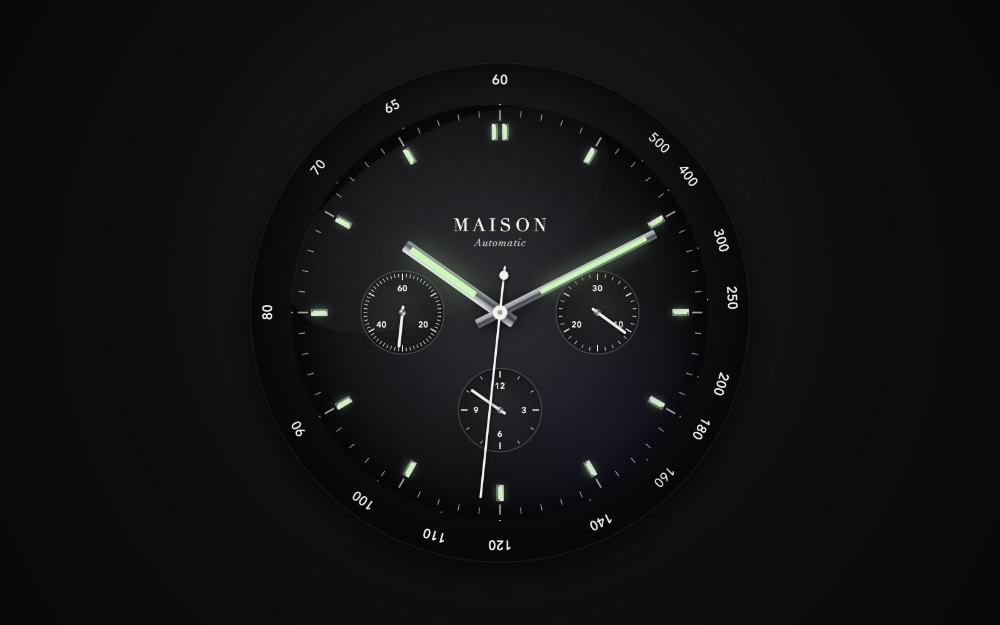
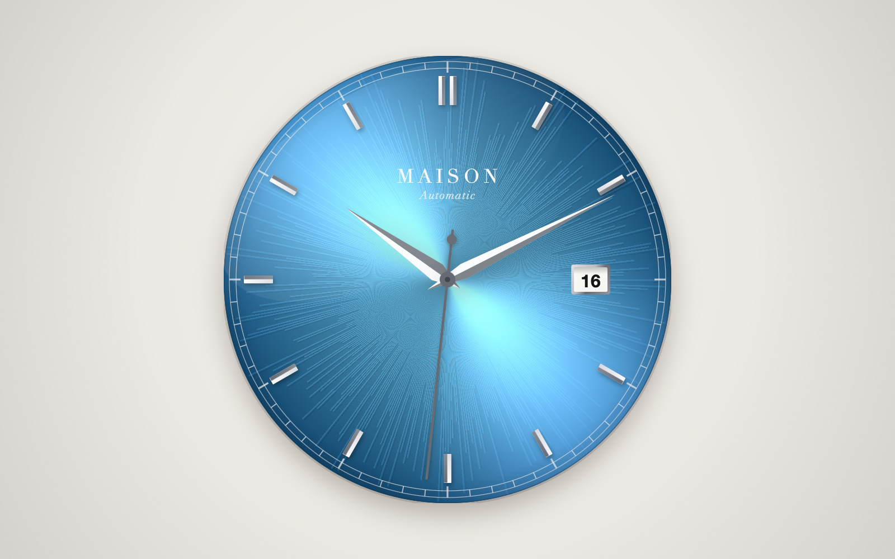

# Tourbillon

**Live watch-dial wallpaper for macOS.** Photorealistic dials inspired by the great Japanese, Swiss and Spanish classics, showing your Mac's real time. Works 100 % offline, follows Light and Dark mode, and also covers the **login screen**, the **lock screen** and the **screen saver**.

<p align="center">
  
  
  
  
</p>

## What it does

| Where | How |
| --- | --- |
| **Desktop** | Live dial at 60 fps, synced to the system clock and time zone. Sits below the Finder icons and pauses itself when hidden or when the display sleeps. |
| **Login and lock screen** | *Apply to login & lock screen* renders a light/dark HEIC (the format Apple uses for its own dynamic wallpapers) at your display's native resolution. |
| **Screen saver** | `Tourbillon.saver` runs the same live dial. It appears on the lock screen when the Mac is idle. |
| **Light / Dark** | Follows macOS automatically. Each dial can have its own *night* version, and the lume glows in dark mode. |

> **About the login window:** macOS only allows a **still** image there, so it shows the design at 10:10 (the classic watch-advert pose). The live animation runs on the desktop and in the screen saver.

## Collection

All dials are procedural (no image files): textures computed pixel by pixel with directional light, faceted indices and hands, drop shadows, a sapphire crystal with reflection, and the seconds motion of each type of movement.

| Origin | Dial | Signature details |
| --- | --- | --- |
| 🇯🇵 Japan | **Snowfield** | Wind-swept snow texture, *glide* seconds (continuous), power reserve, blued hand |
| 🇯🇵 Japan | **Birch** | Vertical bark relief, *razor* faceted hands, 8 beats/s |
| 🇯🇵 Japan | **Cocktail** | Radial grooves with a sunray flare, dauphine hands |
| 🇯🇵 Japan | **Shell Diver** | Large lume plots, day-date, dive scale |
| 🇨🇭 Switzerland | **Submersible** | Gloss dial, round plots, date magnifier (cyclops) |
| 🇨🇭 Switzerland | **GMT** | Two-tone 24 h scale and second time-zone hand |
| 🇨🇭 Switzerland | **Moon Chrono** | Matte black, three registers, tachymeter |
| 🇨🇭 Switzerland | **Datum** | Sunburst, date with magnifier |
| 🇨🇭 Switzerland | **Calatrava** | Dress dial, opaline, small seconds |
| 🇨🇭 Switzerland | **Octagon** | Tapisserie grid |
| 🇨🇭 Switzerland | **Guilloché** | Engine-turned guilloché, Roman numerals, pomme hands, **tourbillon** |
| 🇨🇭 Switzerland | **Pilot** | Large aviation numerals, triangle at 12 |
| 🇨🇭 Switzerland | **Skeleton** | Open-worked movement and **tourbillon** |
| 🇪🇸 Spain | **Racing Chrono** | Racing chronograph, colour registers, quartz tick |
| 🇪🇸 Spain | **Mediterráneo** | Vintage *compressor* diver with an inner scale and orange accents |

**Customisable:** dial colour (day and night), metal of the hands and indices, outer ring colour, date, central seconds, tourbillon (on any dial), lume, signature text and typeface, background (studio, spotlight, solid) with light/dark colours, position, size and frame rate (60/30/15 fps to save battery).

> The designs are *inspired by* well-known styles. They do not reproduce brand names or logos: the signature on the dial is whatever you type.

## Install

You need macOS 13 or later and the Command Line Tools (`xcode-select --install`). Full Xcode is not required.

```bash
git clone https://github.com/<user>/tourbillon-wallpaper.git
```

```bash
cd tourbillon-wallpaper && make install
```

`make install` builds a universal app (Apple Silicon + Intel), copies it to `/Applications` and opens it. A watch icon appears in the menu bar:

- **Live Wallpaper** — turns the live dial on or off
- **Settings…** — editor with a live preview
- **Apply to Login & Lock Screen** — generates and sets the light/dark image
- **Install Screen Saver…** — installs it and opens System Settings so you can choose *Tourbillon*
- **Open at Login**

Every change you make in Settings is applied instantly to the desktop and to the installed screen saver.

### No installation

Open `web/index.html` in a browser to design your dial and download it as a PNG (light and dark). `web/gallery.html` shows the whole collection.

## Structure

```
web/            Rendering engine (Canvas 2D, no dependencies) and editor
  engine.js     Dials, textures, hands, tourbillon, light/dark
  app.js        Editor and native bridge
native/App      Menu bar app (Swift/AppKit + WebKit)
native/Saver    Screen saver (ScreenSaver.framework + WebKit)
scripts/        render.swift: renders PNG/HEIC without touching the desktop
assets/         App icon and screen saver thumbnail
```

The same engine powers the desktop, the screen saver, the login image and the browser, so all four always look identical.

```bash
swift scripts/render.swift docs/test.png 2880 1800 dark cocktail
```

## License

MIT
